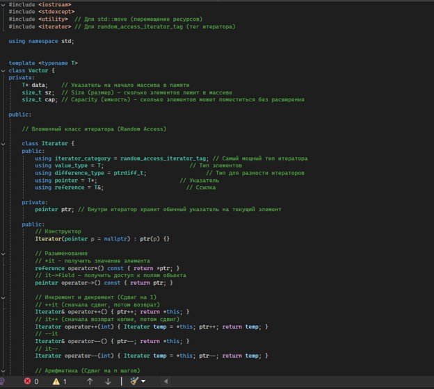
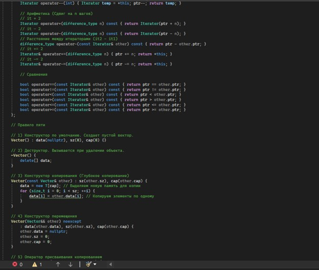
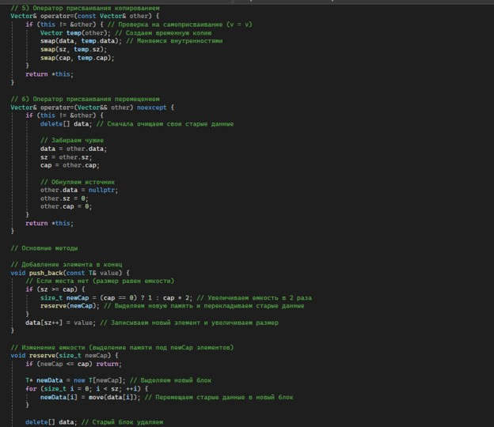
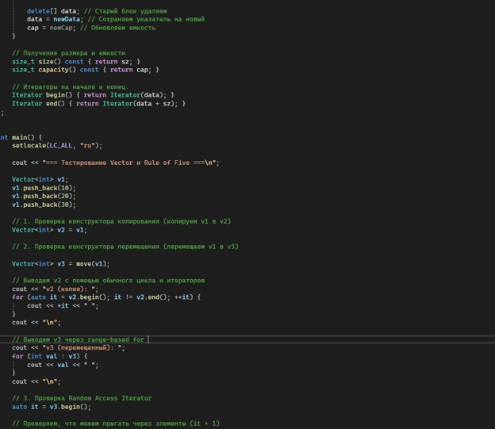
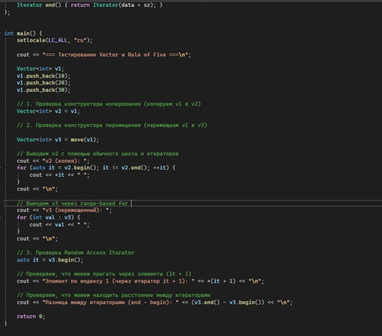

# Лабораторная работа №3
## Реализация динамического массива (аналог vector). Итераторы

**Выполнила:** *Агафонова Софья Сергеевна*  
**Группа:** *ПИЖ-б-о-25-1*  
**Вариант:** 1 (Продвинутый уровень)

---

## Цель работы

1. Реализовать шаблонный класс Vector<T> - аналог std::vector - с
нуля
2. Освоить управление динамической памятью: выделение,
расширение, освобождение
3. Закрепить «правило трёх» (деструктор, конструктор копирования,
оператор присваивания) и освоить «правило пяти» (конструктор и
оператор перемещения)
4. Реализовать итераторы для поддержки range-based for и STLсовместимости
5. Провести амортизированный анализ операции push_back

---

## Теоретическая часть

## 1. Динамическая память и динамические массивы
**Динамическая память** (куча) выделяется во время выполнения программы с помощью `new`/`delete` и не ограничена размером стека. 
**Динамический массив** — это структура данных, которая хранит элементы в непрерывной области памяти, но, в отличие от статического, может менять свой размер во время работы. 

*Основные компоненты `Vector<T>`:* указатель на данные `T* data`, текущий размер `sz` и выделенная ёмкость `cap`. При расширении память перевыделяется, а старые элементы копируются.

## 2. Правило трёх и правило пяти
Управление динамической памятью требует ручного контроля, поэтому применяются эти правила.

*   **Правило трёх:** если классу нужен хотя бы один из трёх методов (деструктор, конструктор копирования, оператор присваивания копированием), то нужны все три. Иначе компилятор сгенерирует поверхностное копирование, что приведет к двойному удалению памяти (double free).
*   **Правило пяти:** расширение правила трёх для C++11. Добавляет конструктор перемещения и оператор присваивания перемещением.

**Особенности реализации:**
*   **Глубокое копирование:** при копировании выделяется новая память и поэлементно копируются данные (чтобы объекты были независимы).
*   **Copy-and-swap:** в операторе присваивания создается временная копия, которая затем обменивается местами с текущим объектом. Это дает строгую гарантию безопасности исключений. Обязательна проверка `if (this != &other)` для защиты от самоприсваивания.
*   **Семантика перемещения:** позволяет «украсть» ресурсы (перекинуть указатель) у временного объекта за `O(1)`, не копируя данные. Помечается `noexcept`, так как не выделяет память и не может выбросить исключение.

## 3. Итераторы
**Итератор** — объект, указывающий на элемент контейнера и позволяющий перебирать элементы. В `Vector` итератором выступает обычный указатель (`T*`), так как данные лежат непрерывно.
*   `begin()` возвращает указатель на первый элемент.
*   `end()` возвращает указатель на элемент *после* последнего (маркер конца).
Этого достаточно для работы `range-based for` и совместимости со STL-алгоритмами (сортировка, поиск).

## 4. Амортизированный анализ (на примере `push_back`)
Амортизированная сложность — это средняя стоимость операции за длинную последовательность действий.
*   Обычно `push_back` работает за `O(1)`.
*   Когда массив заполнен, происходит реаллокация: выделяется память в **2 раза больше**, элементы копируются (это `O(n)`).

**Почему именно удвоение, а не прибавление константы?**
Если прибавлять фиксированное число, реаллокации будут слишком частыми, и суммарное время вставки `n` элементов составит `O(n²)`.
При удвоении элементы копируются только при размерах 1, 2, 4, 8, 16... Суммарное количество копирований для `n` элементов составит `1 + 2 + 4 + ... + n < 2n` (то есть `O(n)`). Следовательно, в пересчете на одну операцию `push_back` сложность составляет **`O(1)` амортизированно**.

## Постановка задачи

**Общее задание:** 
Реализовать шаблонный класс `Vector<T>` — аналог `std::vector` — с нуля. Класс должен поддерживать «правило пяти» (деструктор, конструктор копирования, оператор присваивания копированием, а также конструктор и оператор присваивания перемещением), а также предоставлять итераторы для поддержки range-based for и STL-совместимости.

**Индивидуальное задание :**
Реализовать **итераторы с поддержкой различных категорий** (input, output, forward, bidirectional, random access).

**Требования к реализации:**
1. Создать собственный класс итератора (или набор классов), который удовлетворяет требованиям стандартных категорий итераторов C++.
2. Обеспечить поддержку операций, характерных для **Random Access Iterator** (итератора произвольного доступа), так как элементы `Vector` хранятся в непрерывной области памяти:
   * Инкремент и декремент (`++it`, `--it`, `it++`, `it--`);
   * Разыменование и доступ к членам (`*it`, `it->`);
   * Арифметические операции (`it + n`, `it - n`, `it += n`, `it -= n`);
   * Разность итераторов (`it2 - it1`);
   * Операции сравнения (`==`, `!=`, `<`, `>`, `<=`, `>=`);
   * Доступ по индексу (`it[n]`).
3. Реализовать константные итераторы (`const_iterator`) для безопасного чтения элементов.
4. Обеспечить корректную совместимость реализованных итераторов со стандартными алгоритмами STL (например, `std::sort`, `std::find`, `std::distance`).
---

## Индивидуальное задание

*Рисунок 1- Код программы*

*Рисунок 2- Код программы*

*Рисунок 3- Код программы*

*Рисунок 4- Код программы*
## Результаты работы программы

*Рисунок 5- Результат программы*

## Ответы на контрольные вопросы

# Ответы на контрольные вопросы

**1. Почему динамический массив называется «динамическим»?**
Потому что его размер определяется и изменяется во время выполнения программы (динамически), а не на этапе компиляции. В отличие от статического массива, он может автоматически расширяться при добавлении новых элементов (выделяя память в куче).

**2. Что такое ёмкость (capacity) и чем она отличается от размера (size)?**
*   **Размер (`size`)** — это количество элементов, которые фактически сейчас хранятся в массиве.
*   **Ёмкость (`capacity`)** — это количество элементов, под которые уже выделена память в куче. 
Размер всегда меньше или равен ёмкости. Ёмкость увеличивается только тогда, когда размер превышает её (происходит реаллокация).

**3. Почему при расширении массива ёмкость удваивается, а не увеличивается на фиксированное число?**
При увеличении на фиксированное число (например, +1) реаллокации происходили бы при каждой вставке. Суммарное количество копирований при вставке `n` элементов составило бы `O(n²)`, а амортизированная сложность одной вставки была бы `O(n)`. Удвоение (геометрический рост) обеспечивает суммарно `O(n)` копирований на `n` вставок, что дает амортизированное `O(1)` на операцию.

**4. Какова амортизированная сложность операции push_back? Почему?**
Амортизированная сложность — **`O(1)`**. 
В большинстве случаев `push_back` просто записывает элемент за `O(1)`. При расширении (удвоении) требуется `O(n)` времени на копирование старых элементов. Но так как это происходит редко (в 1, 2, 4, 8... элементах), общее количество копирований для `n` элементов составляет менее `2n`. В пересчете на каждую операцию получаем константное время.

**5. Что такое «правило трёх»? Когда оно применяется?**
Правило, согласно которому, если классу требуется определить хотя бы один из трех методов: **деструктор**, **конструктор копирования** или **оператор присваивания копированием**, то, вероятнее всего, нужно определить все три. 
Применяется, когда класс управляет каким-либо ресурсом (например, динамической памятью). Иначе сгенерированные компилятором по умолчанию методы выполнят поверхностное копирование, что приведет к двойному освобождению памяти (double free).

**6. Что такое «правило пяти»? Чем оно отличается от «правила трёх»?**
Это расширение правила трёх для стандарта C++11. Оно включает в себя два дополнительных метода: **конструктор перемещения** и **оператор присваивания перемещением**. Отличие в том, что правило пяти позволяет классу эффективно использовать семантику перемещения для временных объектов, избегая лишнего глубокого копирования.

**7. В чём разница между конструктором копирования и оператором присваивания?**
*   **Конструктор копирования** вызывается при инициализации нового объекта на основе существующего (`Vector v2 = v1;`). Он создает объект «с нуля».
*   **Оператор присваивания** вызывается, когда объект уже создан, и ему присваивается значение другого объекта (`v2 = v1;`). Перед копированием новых данных оператор должен освободить старые ресурсы объекта.

**8. Зачем нужна проверка `if (this != &other)` в операторе присваивания?**
Это проверка на самоприсваивание (`v = v`). Без нее оператор сначала освободит динамическую память текущего объекта (которая является той же самой, что и у `other`), а затем попытается скопировать данные из уже освобожденной памяти, что приведет к ошибке (неопределенному поведению).

**9. Что такое итератор? Как он связан с указателем?**
Итератор — это объект, предоставляющий доступ к элементам контейнера и позволяющий их перебирать. 
Внутри контейнеров на основе динамического массива (как `Vector`) итератор реализуется с помощью обычного указателя (`T*`). Операции над итератором (разыменование `*`, инкремент `++`, сложение с числом) аналогичны операциям над указателями.

**10. Зачем нужны методы `begin()` и `end()`?**
Они задают диапазон элементов в контейнере в виде полуинтервала `[begin, end)`:
*   `begin()` возвращает итератор на первый элемент.
*   `end()` возвращает итератор на элемент, следующий *за последним* (он не разыменовывается, а служит маркером конца).
Эти методы позволяют единообразно перебирать элементы и использовать стандартные алгоритмы STL (`std::sort`, `std::find`).

**11. Как реализовать range-based for для своего контейнера?**
Цикл `for (auto x : vec)` автоматически разворачивается компилятором в обычный цикл с использованием `begin()` и `end()`. Поэтому достаточно просто реализовать в классе методы `begin()` и `end()` (для константных и неконстантных объектов), возвращающие итераторы.

**12. Что такое «глубокое копирование»? Чем оно отличается от «поверхностного»?**
*   **Поверхностное (shallow)** копирует только значение указателя, в результате чего два объекта указывают на одну и ту же область памяти.
*   **Глубокое (deep)** копирование выделяет новую область памяти и поэлементно копирует туда данные. Объекты становятся полностью независимыми, и при удалении одного данные другого не повреждаются.

**13. Что такое семантика перемещения и зачем она нужна?**
Это механизм C++11, позволяющий «перемещать» ресурсы (например, указатели на память) из одного объекта в другой, вместо их затратного копирования. Используется для временных объектов (rvalue). Нужна для повышения производительности (позволяет избежать `O(n)` копирования, выполняя операцию за `O(1)`).

**14. Почему конструктор перемещения помечается `noexcept`?**
Потому что он не выделяет новую память и не выполняет сложных операций, следовательно, не может выбросить исключение. Пометка `noexcept` критически важна: стандартные контейнеры (например, `std::vector` при своей реаллокации) будут использовать перемещение вместо копирования только в том случае, если конструктор перемещения помечен как не выбрасывающий исключения. Это гарантирует строгую безопасность исключений.

**15. Как правильно освобождать память в деструкторе?**
Память, выделенная с помощью оператора `new[]`, должна освобождаться с помощью оператора `delete[] data;`. Использование просто `delete` (без скобок) для массива приведет к неопределенному поведению и утечкам памяти.

---

## Выводы

В ходе выполнения лабораторной работы я:
1. Реализовала шаблонный класс Vector<T> - аналог std::vector - с
нуля
2. Освоила управление динамической памятью: выделение,
расширение, освобождение
3. Закрепила «правило трёх» (деструктор, конструктор копирования,
оператор присваивания) и освоила «правило пяти» (конструктор и
оператор перемещения)
4. Реализовала итераторы для поддержки range-based for и STLсовместимости
5. Провела амортизированный анализ операции push_back
---

**Ссылка на Git-репозиторий с кодом программы:**  
[https://github.com/agafonovasofa631-collab/-2-.git](https://github.com/agafonovasofa631-collab/-2-.git)
